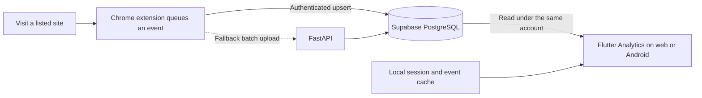

# FocusEcho AI

[](https://github.com/saiteerthakondeti/focusecho/actions/workflows/ci.yml)

FocusEcho helps you return to the task you meant to do. Start a session with an intention, choose which sites or apps tend to distract you, and FocusEcho nudges you when you drift. Afterward, Analytics shows where your attention went and how quickly you returned.

## A focus session from start to finish

1. **Plan the work.** Add a study slot or start a session directly. Write an intention such as “finish the first two calculus problems.” In Chrome, you can pin the tab you want to return to.
2. **Catch a distraction.** The Chrome extension watches tab changes during the session. On Android, a Kotlin foreground service uses Usage Access to detect distracting apps. Interventions escalate with repeated distractions and offer actions such as **Return to Focus** and **Take a Break**.
3. **Save an interruption for later.** Add a thought to the parking lot, or allow a distracting site for the rest of the browser session.
4. **Review the session.** See your score and XP, optionally rate your focus from 1 to 5, and tag why you drifted. Analytics shows daily distractions, top sites and apps, recovery rate, and today's distraction time compared with yesterday's.
5. **Get coaching if you opt in.** The FastAPI backend checks consent before calling Groq for goal refinement or a session debrief. The debrief uses the count of parked items and keeps their text out of the model request. A rule-based fallback covers unavailable model responses.

## How a browser distraction reaches Analytics



The web dashboard shares its Supabase session with the extension. The extension ensures the parent row exists in `focus_sessions` before uploading to `distraction_events`. A recovery updates the original distraction by ID. When authentication or the network is unavailable, the queue retains the event for retry. Analytics merges cloud and local rows by ID and refreshes every 30 seconds while open.

**Verified on November 25, 2026.** A real Chrome visit to `example.org` produced an event whose ID matched both the hosted Supabase row and the Flutter Analytics response. The site then appeared under **Most Distracting Apps**. This run used a locally served Flutter web build and hosted Supabase. The deployed Vercel page and physical Android rendering remain unverified by that run. [Recorded result](STATUS.md)

## Run locally

The examples use PowerShell. Start each numbered setup section from the repository root. For parity with CI, use Flutter **3.47.8**, Python **3.12**, and Node.js **22**. Browser detection requires Chrome with the extension loaded. Android development also requires the Android SDK and a device or emulator.

### 1. Configure Supabase and the clients

Use a Supabase project with anonymous sign-in enabled for the guest flow. The database setup includes the [base schema](backend/supabase_migrations/001_initial_schema.sql), [row-level security policies](backend/supabase_migrations/002_rls_policies.sql), and [dated migrations](backend/supabase_migrations/migrations/). For an existing database, check its applied migrations before running outstanding SQL. Extension uploads require `distraction_events.escalation_level`. [Focus recovery migration](backend/supabase_migrations/migrations/20260830_focus_recovery.sql)

Create `dart_defines.json` in the **repository root** with valid JSON. Both Flutter commands below read this same file.

```json
{
  "SUPABASE_URL": "https://<project-ref>.supabase.co",
  "SUPABASE_ANON_KEY": "<project-anon-key>",
  "BACKEND_URL": "http://localhost:8000"
}
```

Keep the Supabase service-role key, database credentials, and Groq API key in the backend environment. The Flutter config is bundled into the client.

### 2. Start the backend

```powershell
cd backend
python -m venv .venv
.\.venv\Scripts\python -m pip install -r requirements.txt
if (!(Test-Path .env)) { Copy-Item .env.example .env }
```

Fill in `backend/.env` for the same Supabase project. Include `http://localhost:3000` in `ALLOWED_ORIGINS`. For live AI coaching, configure the Groq key, model names, and timeout using the [backend environment template](backend/.env.example). Then start the API from the same terminal.

```powershell
.\.venv\Scripts\python -m uvicorn app.main:app --reload --port 8000
```

Check the [health endpoint](http://localhost:8000/health) or explore the [interactive API docs](http://localhost:8000/docs).

### 3. Open the Flutter dashboard and connect Chrome

In a second terminal, run the following. Using the web server lets you open the dashboard in the same Chrome profile where you install the extension.

```powershell
cd mobile_app
flutter pub get
dart run build_runner build --delete-conflicting-outputs
flutter run -d web-server --web-hostname=localhost --web-port=3000 --dart-define-from-file=../dart_defines.json
```

Open `chrome://extensions`, enable **Developer mode**, choose **Load unpacked**, and select the repository's `browser_extension` folder. Open the [Flutter dashboard](http://localhost:3000) in that Chrome profile, complete onboarding, and start a focus session. To try the data flow, visit a site from your distraction list, return to FocusEcho, and open **Analytics**. The separate [static web demo](web/) uses example metrics.

### 4. Run on Android

From `mobile_app/`, run `flutter devices` and choose an Android device. An emulator reaches a backend on your development machine through `10.0.2.2`. For a USB-connected phone, you can use `adb reverse tcp:8000 tcp:8000` with the localhost backend URL.

```powershell
flutter run -d <device-id> --dart-define-from-file=../dart_defines.json
```

Grant Usage Access during onboarding. For release builds, run `flutter build apk --release --dart-define-from-file=../dart_defines.json` or `flutter build web --release --dart-define-from-file=../dart_defines.json` from the same directory. Set `BACKEND_URL` to the API address your intended users can reach.

## Tests and evidence

The CI gate expects **400 cases in each of seven suites**. The verified run for commit `acfad28` passed **2,800 cases with zero failures and zero skips**. The suites cover backend, QA catalogue controls, Flutter, browser extension, Selenium acceptance on the static demo, load smoke, and vulnerability checks. Counts include parameterized scenarios. The results artifact contains the combined workbook at `Test Results/Excel/Full_Test_Suite_Report.xlsx`. [Verified CI run](https://github.com/saiteerthakondeti/focusecho/actions/runs/45540742000) · [CI workflow](.github/workflows/ci.yml)

| Check | Working directory | Command |
| --- | --- | --- |
| Backend API and unit tests | `backend/` | Install `pytest==8.3.5` in the backend environment, then run `.\.venv\Scripts\python -m pytest app/tests -q` |
| Flutter analysis and tests | `mobile_app/` | Run `flutter analyze --no-pub --no-fatal-infos`, then `flutter test --no-pub` |
| Extension tests | `browser_extension/` | Run `npm install`, then `npm run test:all` |
| Local extension-to-Analytics integration | `mobile_app/` | `flutter test tool/extension_analytics_test.dart` |

**Repeat the hosted Chrome check** when you need evidence that browser detection, cloud persistence, and chart rendering work together. Use a hosted test project that permits anonymous sign-in. Each run creates a test user and session. From the root, with the client configuration and Flutter dependencies prepared above, run:

```powershell
cd mobile_app
flutter build web --release --no-web-resources-cdn --dart-define-from-file=../dart_defines.json
cd ../browser_extension
npm install
npx puppeteer browsers install chrome
cd ..
node browser_extension/tests/hosted-analytics-smoke.mjs
```

The script launches an isolated Chrome profile with the extension, verifies an empty chart, visits one listed site, checks the event ID against hosted Supabase, and checks the rendered site label. [Hosted smoke test](browser_extension/tests/hosted-analytics-smoke.mjs)

## Repository guide

| Location | What lives there |
| --- | --- |
| [mobile_app](mobile_app/) | Shared Flutter Android and web UI, local storage, sync services, and native Android detection |
| [browser_extension](browser_extension/) | Manifest V3 service worker, distraction detection, popup, overlays, and cloud upload |
| [backend](backend/) | FastAPI routes, scoring, EchoCoach, and Supabase schema |
| [automation](automation/) | Selenium acceptance, load and security checks, and report generation |
| [web](web/) | Standalone static demo exercised by Selenium |
| [docs](docs/) | [Architecture notes](docs/architecture.md), [QA catalogue](docs/QA_TEST_CASE_CATALOGUE.md), and [privacy policy](docs/privacy_policy.md) |
